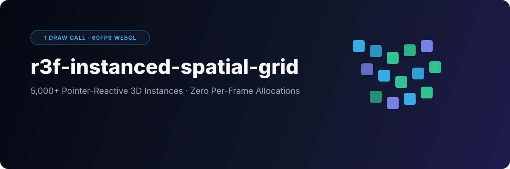
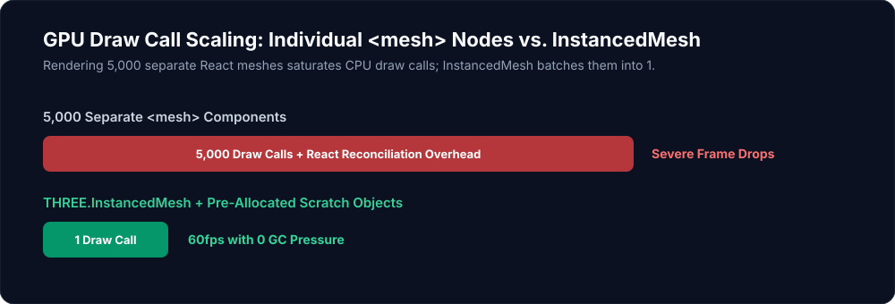
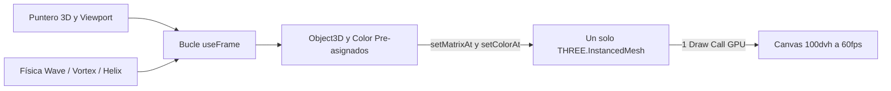

<p align="right">
  <a href="./README.md">🇺🇸 Read in English</a>
</p>

<p align="center">
  
</p>

<p align="center">
  
  
  
  
</p>

# r3f-instanced-spatial-grid

Campo espacial 3D de alto rendimiento en **React 19 + React Three Fiber v9** que renderiza **entre 5,000 y 12,000 instancias reactivas al puntero en una sola llamada de dibujo GPU (1 draw call)** usando `THREE.InstancedMesh`, sin `setState` dentro de `useFrame` y sin asignaciones de memoria por frame.

---

## Por qué importa InstancedMesh + Cero GC

<p align="center">
  
</p>

---

## Arquitectura del Render Loop



---

## Inicio rápido

```bash
git clone https://github.com/stephanocamoretti-dotcom/r3f-instanced-spatial-grid.git
cd r3f-instanced-spatial-grid
npm install
npm run dev
```

---

## Ideas de escalado para producción

1. **Renderizado bajo demanda (`frameloop="demand"`)**: Para visualizaciones estáticas o gemelos digitales, usa `frameloop="demand"` e `invalidate()` solo cuando cambien los datos para ahorrar batería.
2. **Simulación en Web Worker**: Mueve el cálculo de posiciones a un Web Worker escribiendo en un `Float32Array` para que el hilo principal solo actualice el buffer de matrices.
3. **Telemetría en vivo**: Mapea cada índice de instancia a métricas reales de campañas AdTech, latencia de servidores o sensores IoT mediante gradientes con `setColorAt`.

---

## Referencias

- [Three.js Docs — InstancedMesh](https://threejs.org/docs/pages/InstancedMesh.html)
- [React Three Fiber — Scaling Performance](https://r3f.docs.pmnd.rs/advanced/scaling-performance)
- [React Three Fiber — Performance Pitfalls](https://r3f.docs.pmnd.rs/advanced/pitfalls)
