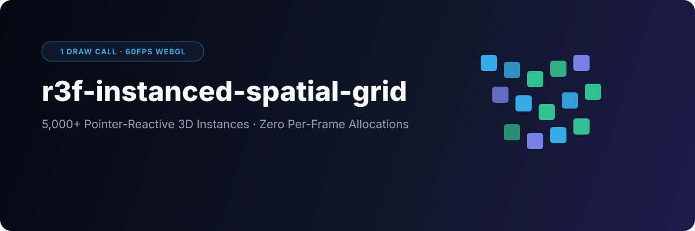
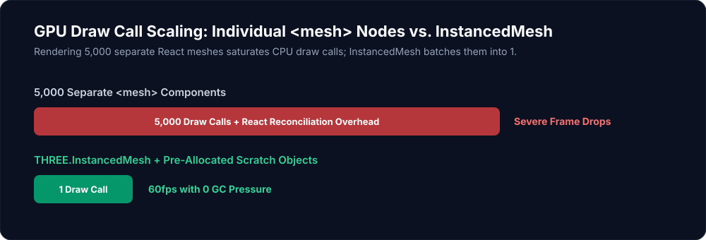
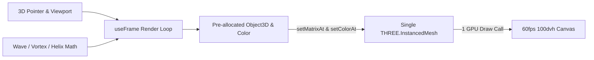

<p align="right">
  <a href="./README.es.md">🇪🇸 Leer en Español</a>
</p>

<p align="center">
  
</p>

<p align="center">
  
  
  
  
</p>

# r3f-instanced-spatial-grid

A high-performance **React 19 + React Three Fiber v9** spatial 3D field rendering **5,000 to 12,000 pointer-reactive instances in a single GPU draw call** using `THREE.InstancedMesh`—with zero React `setState` inside `useFrame` and zero per-frame object allocations.

---

## Why InstancedMesh + Zero-GC Matters

<p align="center">
  
</p>

---

## Frame Loop Architecture



---

## Quick Start

```bash
git clone https://github.com/stephanocamoretti-dotcom/r3f-instanced-spatial-grid.git
cd r3f-instanced-spatial-grid
npm install
npm run dev
```

---

## Scaling Ideas for Production

1. **On-Demand Rendering (`frameloop="demand"`)**: For static data visualizations (like 3D heatmaps or warehouse digital twins), switch `<Canvas frameloop="demand">` and call `invalidate()` only on pointer or data updates to save laptop battery.
2. **Web Worker Physics Offload**: Move position/force integration into a Web Worker writing to a `Float32Array` `SharedArrayBuffer` so the main thread only uploads `instanceMatrix` buffers.
3. **Interactive Telemetry Mapping**: Bind each instance index to live AdTech spend, server latency, or IoT sensor metrics using `setColorAt` gradients.

---

## References

- [Three.js Docs — InstancedMesh](https://threejs.org/docs/pages/InstancedMesh.html)
- [React Three Fiber — Scaling Performance & Pitfalls](https://r3f.docs.pmnd.rs/advanced/scaling-performance)
- [React Three Fiber — Performance Pitfalls (useFrame)](https://r3f.docs.pmnd.rs/advanced/pitfalls)
